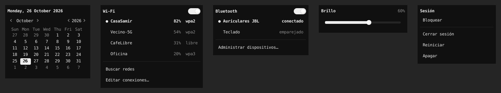
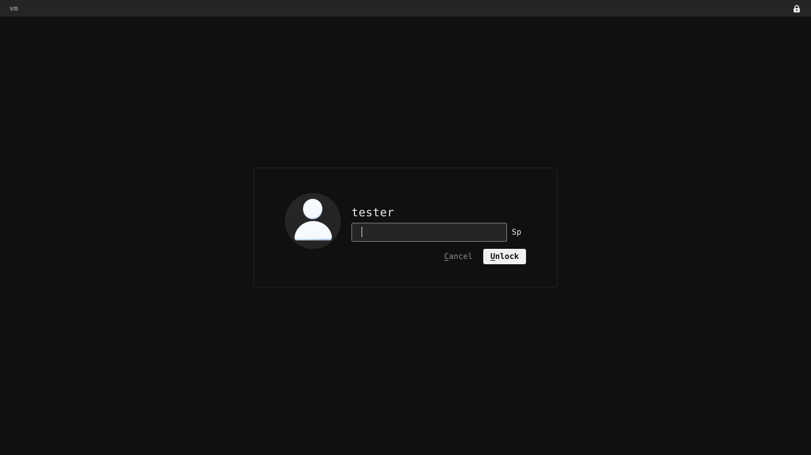

# onyx-xfce

Una barra superior **negra, monocromática y funcional** para XFCE, construida
solo con el panel de XFCE y sus plugins nativos (`genmon`, `pager`, `systray`,
`pulseaudio`, `xkb`, `launcher`), con el mismo diseño hasta en el menú de sesión
y la pantalla de bloqueo. Sin i3, Polybar, Rofi ni compositores.

Pensada para un portátil antiguo (Linux Mint 22.3 XFCE, AMD A10-9600P,
6 GB de RAM, HDD, pantalla de 1366 × 768): refrescos espaciados, ningún sondeo
costoso, estado temporal en RAM (tmpfs) y casi ningún proceso residente.

Inspiración visual: [Solaire9886/dotfiles](https://github.com/Solaire9886/dotfiles)
y [Miraakz9/Light-i3-dotfiles](https://github.com/Miraakz9/Light-i3-dotfiles).
No se copió su configuración: todo se escribió desde cero para XFCE.






> Las capturas se generaron en un entorno de prueba (Xvfb a 1366 × 768, XFCE
> 4.18.4). Los sensores, NetworkManager, BlueZ, el reproductor y el clima eran
> simulados; ver [Verificación](#verificación).

---

## Qué incluye

| Zona | Módulo | Fuente de datos | Refresco | Clic |
|---|---|---|---|---|
| Izq. | Escritorios `-` `--` `---` | Workspace Switcher (pager) nativo | instantáneo | cambia de escritorio |
| Izq. | Brave Origin (único lanzador) | su archivo `.desktop` | — | abre el navegador |
| Izq. | Bandeja (Dropbox, Nextcloud…) | Status Tray nativo | instantáneo | menú de cada app |
| Izq. | Música: `♫ Título ❚❚` | MPRIS vía `playerctl --follow` | por eventos | play / pausa |
| Centro | Reloj `Oct 26 · 4:27 PM` | builtins de Bash | 10 s | calendario |
| Der. | CPU `12%` | `/proc/stat` | 12 s | — |
| Der. | RAM `41%` | `/proc/meminfo` (MemAvailable) | 12 s | — |
| Der. | Temperatura `58°C` | hwmon: `k10temp` › `acpitz` › `amdgpu` | 12 s | — |
| Der. | Clima Santa Cruz `31°C` | Open-Meteo, caché de 45 min | 10 min (lee caché) | — |
| Der. | Bluetooth | rfkill + sysfs; BlueZ por D-Bus | 15 s | activar/desactivar, dispositivos |
| Der. | Wi-Fi / cable | sysfs, `/proc/net/wireless`; NetworkManager por D-Bus | 15 s | redes, contraseña, editor |
| Der. | Volumen | plugin PulseAudio nativo (PipeWire en Mint 22) | instantáneo | control deslizante, rueda |
| Der. | Brillo `60%` | `/sys/class/backlight` ; logind `SetBrightness` | 15 s | control deslizante |
| Der. | Teclado `US` / `ES` | plugin xkb nativo | instantáneo | cambia de distribución |
| Der. | Sesión ⏻ | lanzador nativo + ventana Onyx | — | bloquear · cerrar sesión · reiniciar · apagar |

No hay batería, cargador ni información de energía de la batería en ningún
módulo; el instalador además oculta el icono de bandeja de xfce4-power-manager.

Comportamiento ante hardware ausente (sin botones falsos):

- **Temperatura**, **Brillo**, **Bluetooth**: si no existe el sensor, la
  retroiluminación o el adaptador, el módulo desaparece sin dejar hueco.
- **Música**: se oculta mientras no hay un reproductor reproduciendo o en pausa.
- **Brave Origin**: si no está instalado, no se ancla ningún lanzador.
- **Clima**: sin conexión muestra `--°C` atenuado y reintenta cada 5 min.

### Por qué la barra son tres paneles

El panel de XFCE 4.18 no puede centrar un elemento respecto a la pantalla: con
separadores expansibles el reloj solo queda centrado si los grupos izquierdo y
derecho miden exactamente lo mismo, y se movería cada vez que aparece la música
o un icono de la bandeja. Por eso la barra son **tres paneles de 27 px** que se
solapan unos píxeles y se ven como una sola franja continua:

```
panel 1 (arriba-izq., 43 %)   panel 2 (arriba-centro, 15 %)   panel 3 (arriba-der., 43 %)
[- -- ---] [Brave] [bandeja] [música]   [ Oct 26 · 4:27 PM ]   [CPU RAM TEMP CLIMA BT WIFI VOL BRILLO US ⏻]
```

El panel central está anclado al centro de la pantalla, así que el reloj
queda centrado al píxel pase lo que pase a los lados.

### Menú de sesión y pantalla de bloqueo

- **Botón ⏻**: abre una ventana Onyx con *Bloquear*, *Cerrar sesión*,
  *Reiniciar* y *Apagar*. Las tres últimas piden confirmación en la misma
  ventana («¿Apagar el equipo?» · Cancelar / Apagar) y el foco queda en
  *Cancelar*, así que Enter nunca apaga por accidente. Se ejecutan con
  `xfce4-session-logout` (o `systemctl` / `loginctl` si no existe).
- **Bloqueo y desbloqueo**: Mint XFCE bloquea con *light-locker*, que muestra
  la pantalla de inicio de LightDM; cambiarla exige root y afecta también al
  login. Onyx usa en su lugar **xfce4-screensaver**, el bloqueador propio de
  XFCE, cuyo diálogo de desbloqueo es una ventana GTK de tu sesión: fondo negro
  plano, la barra superior Onyx, avatar redondo, campo de contraseña gris y
  botón *Desbloquear* blanco, con los mensajes de error en gris. Para tu
  usuario se desactiva el autoarranque de light-locker (sin tocar archivos del
  sistema) y se configura: solo pantalla en negro (sin animaciones), bloqueo
  al activarse y al suspender. `restore.sh` vuelve a light-locker.

## Requisitos

- Linux Mint 22.x XFCE (o Ubuntu/Debian con XFCE ≥ 4.16), sesión **X11**.
- Paquetes (el instalador detecta los que faltan y solo instala esos, con
  `sudo apt-get install --no-install-recommends`):

  | Paquete | Para qué |
  |---|---|
  | `xfce4-genmon-plugin` | módulos de texto e icono |
  | `xfce4-pulseaudio-plugin`, `xfce4-xkb-plugin` | volumen, teclado |
  | `playerctl` | música (MPRIS) |
  | `curl` | descarga del clima |
  | `python3-gi`, `gir1.2-gtk-3.0` | ventanas emergentes (ya vienen en Mint) |
  | `xfce4-screensaver` | bloqueo de pantalla con diseño Onyx |
  | `fonts-dejavu-core` | fuente DejaVu Sans Mono (ya viene en Mint) |
  | `rfkill`, `util-linux`, `x11-utils`, `dbus-bin`, `xfconf` | utilidades base |

- Opcionales, ya presentes en Mint XFCE: `blueman` (gestor Bluetooth completo),
  `network-manager-gnome` (editor de conexiones), `pavucontrol` (mezclador).

No se instala ningún framework, compositor ni fuente con iconos, y no se tocan
kernel, firmware, controladores AMD, particiones, arranque ni servicios.

## Instalación

```bash
git clone https://github.com/dani3lsamir/onyx-xfce.git
cd onyx-xfce
./install.sh --dry-run   # comprueba todo y muestra los cambios, sin aplicarlos
./install.sh             # pregunta antes de cambiar nada
```

Ejecútalo como tu usuario, dentro de la sesión XFCE (no con `sudo`). Opciones:
`--yes` (sin preguntas), `--no-deps` (no llamar a apt).

El instalador:

1. Verifica sistema, versión del panel, sesión X11 y dependencias.
2. Detecta Brave Origin (`brave-origin*.desktop` en las rutas de apt, Flatpak
   y Snap; puedes forzarlo con `ONYX_BROWSER_DESKTOP=/ruta/archivo.desktop`) y
   el hardware: sensores, retroiluminación, Bluetooth, Wi-Fi.
3. Muestra la lista exacta de cambios y pide confirmación.
4. Crea un respaldo en `~/.local/share/onyx-xfce/backups/`. El de la **primera**
   ejecución se llama `original` y nunca se sobrescribe; las siguientes crean
   respaldos con fecha. Se guardan: la configuración del panel
   (`xfce4-panel.xml` + `~/.config/xfce4/panel/`), `gtk.css`, `.bashrc` y los
   valores previos de escritorios, distribución de teclado, icono de energía y
   bloqueo de pantalla (qué bloqueador había y sus ajustes).
5. Copia los archivos, reconstruye el panel y cambia el bloqueador.

Es seguro ejecutarlo varias veces. No borra programas, no toca Firefox ni Brave
Origin y conserva tu `onyx.conf` si ya existe. En `gtk.css` y `.bashrc` solo
añade un bloque marcado `>>> onyx-xfce >>>`, el resto queda intacto.

## Restauración

```bash
./restore.sh             # vuelve al estado anterior a la primera instalación
./restore.sh --list      # lista los respaldos
./restore.sh --from 20261026-222125
```

Restaura el panel tal como estaba, los escritorios, la distribución de teclado,
el icono de energía y el bloqueador anterior (light-locker vuelve a arrancar;
xfce4-screensaver queda instalado pero desactivado si no estaba antes); quita
los bloques de `gtk.css` y `.bashrc`, y elimina los archivos instalados. Los
respaldos y tu `onyx.conf` se conservan.

## Estructura

```
install.sh, restore.sh       instalador y restaurador
lib/common.sh                utilidades compartidas (respaldo, bloques marcados, xfconf)
lib/panel-layout.sh          definición completa de la barra (paneles y plugins)
bin/onyx-common.sh           funciones comunes de los módulos
bin/onyx-clock               reloj "Oct 26 · 4:27 PM"
bin/onyx-cpu, onyx-ram       uso de CPU y RAM
bin/onyx-temp                temperatura interna (hwmon)
bin/onyx-weather             clima con caché y descarga en segundo plano
bin/onyx-music               módulo de música + escucha de eventos MPRIS
bin/onyx-bluetooth           estado Bluetooth
bin/onyx-network             estado Wi-Fi / cable
bin/onyx-brightness          brillo
bin/onyx-popup               ventanas: calendario, Wi-Fi, Bluetooth, brillo, sesión (Python + GTK 3)
config/onyx.conf             ajustes del usuario (ubicación del clima, sensor, umbrales…)
config/gtk-3.0/onyx-panel.css estilo de la barra y de la pantalla de bloqueo
config/bash/prompt.bash      prompt de Bash
config/terminal/onyx.theme   esquema de color opcional para xfce4-terminal
icons/Onyx/                  iconos SVG monocromos (solo se usan dentro del panel)
```

Destino de la instalación: `~/.local/share/onyx-xfce/bin/`,
`~/.local/share/icons/Onyx/`, `~/.config/gtk-3.0/onyx-panel.css`,
`~/.config/onyx-xfce/` y `~/.local/share/xfce4/terminal/colorschemes/`.

## Cómo funciona cada parte

- **genmon** ejecuta cada script periódicamente y muestra su salida
  (`<icon>`, `<txt>`, `<tool>`, `<txtclick>`). Los scripts solo leen `/proc` y
  `/sys` con builtins de Bash: no hacen esperas ni sondeos, y no llaman a
  `sensors`, `awk` ni `date`. Lo que se lanza en segundo plano (escucha de
  música, descarga del clima) cierra antes todos los descriptores heredados:
  genmon le pasa los suyos y, si no, el plugin quedaría esperando.
- **Estado temporal** (muestra anterior de CPU, caché del clima, estado de la
  música) en `$XDG_RUNTIME_DIR/onyx-xfce` (tmpfs): ningún refresco escribe en
  el disco duro.
- **Música**: un único proceso `playerctl --follow` espera eventos D-Bus; cuando
  cambia la canción o el estado, guarda la línea y pide al panel que redibuje
  ese módulo. Sin reproductor no consume CPU. Todo el módulo es un solo botón:
  el icono, el título truncado y `❚❚` / `▶` según el estado.
- **Clima**: genmon corre dentro del panel de forma síncrona, así que la
  descarga nunca ocurre ahí: si la caché caducó (45 min) se lanza `curl` en
  segundo plano y, al terminar, el panel refresca el módulo.
- **Ventanas emergentes** (`onyx-popup`): un proceso por clic que termina al
  cerrar (Esc, clic fuera o clic de nuevo en el módulo). Hablan directamente
  por D-Bus con NetworkManager, BlueZ y logind; el brillo usa
  `SetBrightness` de logind, que no requiere root.
- **Iconos**: tema `Onyx` de SVG con formas rellenas que GTK recolorea según el
  CSS. Solo se aplica dentro del panel mediante `-gtk-icon-theme`, así que el
  resto del sistema conserva tu tema de iconos.

## Personalización

- **Ajustes** en `~/.config/onyx-xfce/onyx.conf` (se releen en cada refresco):
  coordenadas y nombre del lugar del clima, duración de la caché, sensor de
  temperatura (`auto`, `k10temp`, `acpitz`, `amdgpu` o una ruta), umbrales de
  aviso (70 °C resaltado, 80 °C invertido), dispositivo de brillo, longitud del
  título de la música, reproductores ignorados, idioma del mes del reloj y
  `ONYX_CLOCK_AMPM` (`full` = `4:27 PM`, `short` = `4:27 P`).
- **Colores, márgenes, fuente**: variables `@define-color` al inicio de
  `~/.config/gtk-3.0/onyx-panel.css`. Tras editarlo: `xfce4-panel -r`.
- **Frecuencia de un módulo**: clic derecho › Propiedades en el módulo, o
  `UpdatePeriod` en `~/.config/xfce4/panel/genmon-N.rc`. Para que sobreviva a
  una reinstalación, cámbialo en `lib/panel-layout.sh`.
- **Quitar o reordenar módulos**: edita las listas `_panel 1/2/3` de
  `lib/panel-layout.sh` y vuelve a ejecutar `./install.sh`. Los ids de plugin
  se usan como selectores en el CSS (`#genmon-9`, `#pager-1`…).
- **Iconos de la bandeja**: Wi-Fi (nm-applet), Bluetooth (blueman) y energía
  tienen módulo propio, así que sus iconos se ocultan de la bandeja; la flecha
  `>` de la bandeja los muestra. Se cambia en Propiedades de la bandeja.
- **Distribuciones de teclado**: Configuración › Teclado › Distribución.
- **Prompt**: `~/.config/onyx-xfce/prompt.bash`. Con
  `ONYX_PROMPT_GIT_DIRTY=1` muestra `*` si hay cambios sin confirmar (eso sí
  ejecuta `git`; por defecto la rama se lee sin procesos extra).
- **Terminal**: Preferencias de xfce4-terminal › Colores › Esquema `Onyx`.
- **Pantalla de bloqueo**: sección `lock screen` de `onyx-panel.css`. Para ver
  tu fondo de escritorio detrás del diálogo, borra la línea
  `-gtk-icon-transform: scale(0)`. Tiempo de espera y demás: Configuración ›
  Salvapantallas (xfce4-screensaver).

## Terminal

```
daniel ~/proyectos/onyx-xfce  main  [1] $
```

Usuario en blanco, directorio en gris claro, rama de Git en gris, código de
salida solo cuando no es 0 y `$` (o `#` como root). Solo ASCII: no requiere
fuentes con iconos. Muestra `usuario@equipo` en SSH y el entorno virtual de
Python si hay uno activo. El nombre de la rama nunca se evalúa como código.

## Consumo

Medido en el entorno de prueba (Xeon 2,8 GHz, 4 núcleos), barra completa en
reposo durante 3 minutos:

- **CPU**: ≈ 0,4 % de un núcleo para todo el panel, incluidos los procesos de
  plugins de XFCE. Cada refresco de un módulo cuesta ≈ 3–4 ms, casi todo el
  arranque del proceso. En el A10-9600P cabe esperar del orden del doble
  (estimación, no medida en ese equipo).
- **Memoria**: ≈ 106 MiB PSS para panel + 14 plugins. La mayor parte son los
  procesos `wrapper-2.0` que XFCE crea por cada plugin externo (≈ 5–7 MiB cada
  uno). Residentes propios de Onyx: solo `onyx-music watch` (≈ 3 MiB) y
  `playerctl` (≈ 6 MiB). xfce4-screensaver (≈ 5,5 MiB) sustituye a
  light-locker, y el botón de sesión ya no usa un proceso de plugin aparte.
- **Disco**: ninguna escritura periódica.
- **Red**: una petición HTTPS al clima cada 45 min.

## Verificación

Lo que se comprobó, y cómo, en Ubuntu 24.04 con XFCE 4.18.4, genmon 4.1.1,
pulseaudio-plugin 0.4.8 y xkb-plugin 0.8.3 (las mismas versiones que Mint 22),
bajo Xvfb a 1366 × 768 con xfwm4:

- [x] Instalación sobre un usuario nuevo con un panel inferior "tipo Mint",
      `gtk.css` y `.bashrc` propios; segunda y tercera instalación (idempotente).
- [x] `restore.sh`: el `xfce4-panel.xml` restaurado es idéntico al original;
      vuelven los 4 escritorios con sus nombres, `gtk.css` y `.bashrc`; no quedan
      procesos de Onyx.
- [x] Tres botones `- -- ---` siempre visibles; clic en cada uno cambia de
      escritorio (comprobado con `_NET_CURRENT_DESKTOP`).
- [x] Reloj `Oct 26 · 11:06 PM` centrado: el panel central ocupa
      581–785 px, centrado en 683 px; clic abre y cierra el calendario.
- [x] Música con un reproductor MPRIS simulado: aparece, clic alterna
      reproducir/pausa (varias veces seguidas), `❚❚`/`▶` cambia, y desaparece
      sin hueco al cerrar el reproductor.
- [x] CPU 26 % frente a 26 % de `vmstat` con un núcleo de cuatro ocupado;
      RAM igual a `free` (total − disponible).
- [x] Temperatura, brillo y Bluetooth con sysfs simulado (k10temp 58 °C,
      amdgpu_bl0, hci0 conectado) y ocultos cuando no existen.
- [x] Ventana Wi-Fi contra un NetworkManager simulado: lista, red guardada,
      red nueva con contraseña (`AddAndActivateConnection` con `wpa-psk`),
      desconexión. Bluetooth contra un BlueZ simulado: encender/apagar,
      conectar dispositivo. Brillo: llamada `SetBrightness` a logind simulado.
- [x] Teclado: clic cambia `US` → `ES` (`setxkbmap` muestra `us,es`).
- [x] Menú de sesión: *Bloquear* activa la pantalla de bloqueo; *Apagar*,
      *Reiniciar* y *Cerrar sesión* piden confirmación, Enter cancela, y al
      confirmar llaman a `xfce4-session-logout --halt / --reboot / --logout`
      (comprobado con un sustituto que registra la llamada).
- [x] Pantalla de bloqueo de xfce4-screensaver 4.18.3 con el diseño Onyx,
      también con el mensaje de contraseña incorrecta.
- [x] Cambio de bloqueador: con light-locker activo (simulado), el instalador
      instala xfce4-screensaver con apt, lo arranca y desactiva light-locker
      para el usuario; `restore.sh` vuelve a arrancar light-locker y deja
      xfce4-screensaver desactivado.
- [x] Bandeja con dos iconos XEmbed (Dropbox/Nextcloud simulados) alineados;
      nm-applet oculto.
- [x] Al salir el panel no quedan procesos de plugin colgados (≈ 2 s) y tras
      `restore.sh` no queda ningún proceso de Onyx.
- [x] Una sola fila a 1366 px sin solapamientos; `shellcheck` sin avisos.

**No se pudo verificar** (no hay ese hardware o servicio en el entorno de
prueba) — revisa estos puntos en tu equipo:

- Sensores reales del A10-9600P: el nombre (`k10temp`, `acpitz`, `amdgpu`) y
  si `k10temp` da valores fiables en la familia 15h. Si no, fija otro sensor
  en `onyx.conf`; el tooltip del módulo lista todos los disponibles.
- NetworkManager, BlueZ, logind y PipeWire reales (se usaron simulaciones de
  su API D-Bus). En particular: que el polkit de Mint permita cambiar el brillo
  vía logind sin contraseña (hay respaldo con `brightnessctl` o
  `xfpm-power-backlight-helper`).
- La descarga real de Open-Meteo (la red del entorno la bloqueaba; el análisis
  se probó con una respuesta real de ejemplo).
- El nombre exacto del `.desktop` de Brave Origin (se busca `brave-origin*`).
- El aspecto con el tema GTK de Mint (Mint-Y); se probó con Adwaita.
- light-locker real (aquí no puede arrancar sin LightDM) y que Mint 22.3 lo use
  de verdad: el instalador detecta cuál hay y lo muestra antes de aplicar.
- Desbloquear con tu contraseña real y el bloqueo al suspender.
- Iconos reales de Dropbox/Nextcloud y su menú.

## Limitaciones conocidas

- **Tres paneles**: en Preferencias del panel aparecen como Panel 1, 2 y 3.
  Es la única forma en XFCE 4.18 de mantener el reloj centrado de verdad.
- **genmon no admite rueda del ratón**: el brillo se ajusta con el control de
  su ventana (que sí acepta rueda y flechas). El volumen sí admite rueda.
- **Reloj**: refresca cada 10 s, así que el minuto puede cambiar hasta 10 s
  tarde (compromiso para no despertar la CPU más a menudo).
- **Cambios de brillo con las teclas** del portátil se reflejan en el módulo en
  el siguiente refresco (≤ 15 s).
- **Volumen**: el porcentaje aparece en el tooltip y en la ventana del plugin,
  no en la barra (el plugin nativo no tiene etiqueta de texto).
- **Ventana del volumen** (plugin nativo) sigue el tema GTK del sistema.
- **Reloj de la pantalla de bloqueo**: xfce4-screensaver lo escribe siempre en
  24 h (`%A, %B %e %H:%M`) y no se puede configurar, así que se oculta para no
  contradecir el `AM/PM` de la barra.
- **Pantalla de login al encender** (LightDM) no se modifica: cambiarla
  requiere root y archivos del sistema.
- **Avatar** del bloqueo: es el de tu cuenta (`~/.face` o AccountsService);
  si no tienes, se ve el icono genérico del tema.
- **Iconos de la bandeja**: son los de cada aplicación; solo se vuelven
  monocromos si la aplicación ofrece una variante simbólica.
- Las ventanas emergentes necesitan ~0,3–0,5 s en abrir la primera vez desde un
  HDD (arranque de Python/GTK); no quedan residentes.
- **Bluetooth**: el estado mostrado es el del interruptor rfkill (el mismo que
  usa blueman); si apagas el adaptador con `bluetoothctl power off` sin rfkill,
  el icono no lo refleja.

## Licencia

[MIT](LICENSE).
